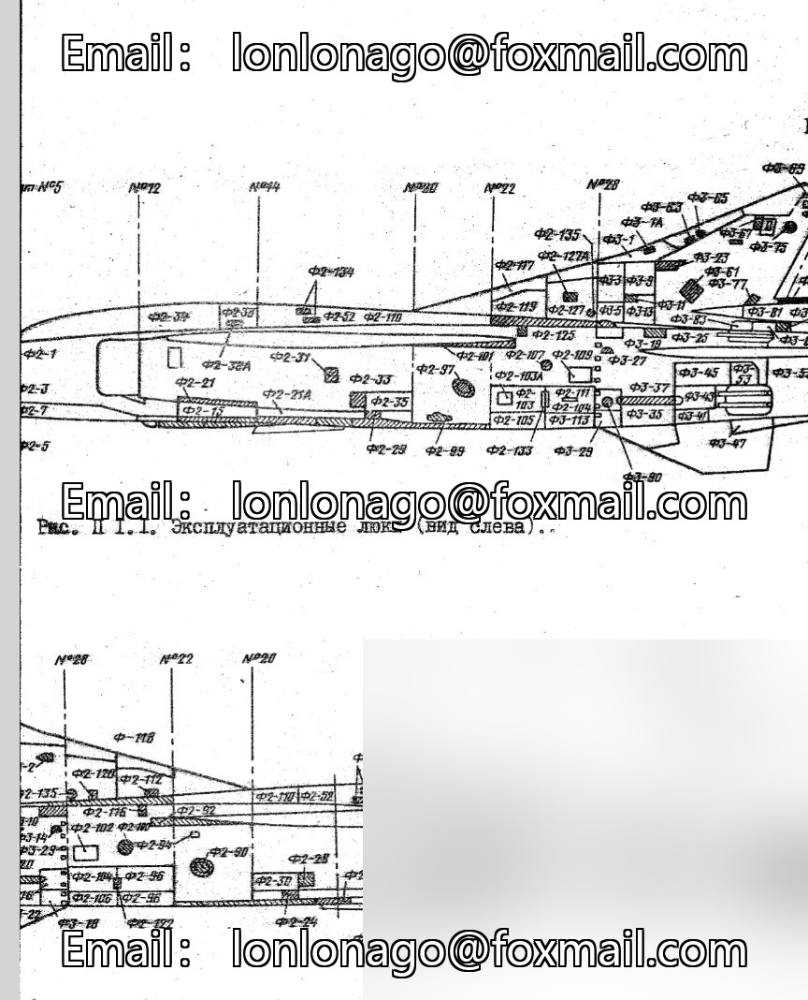
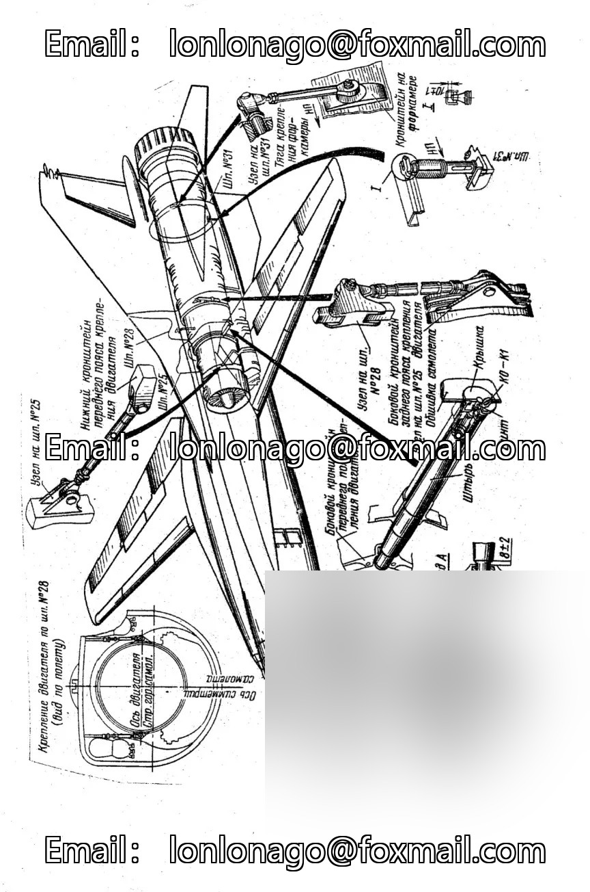
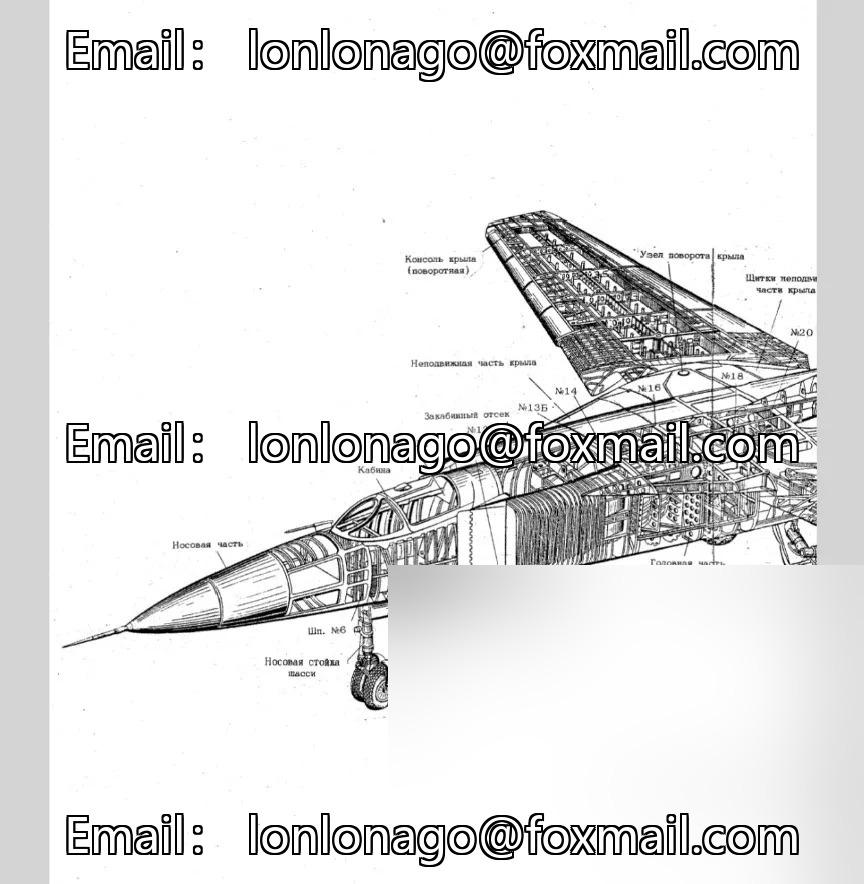
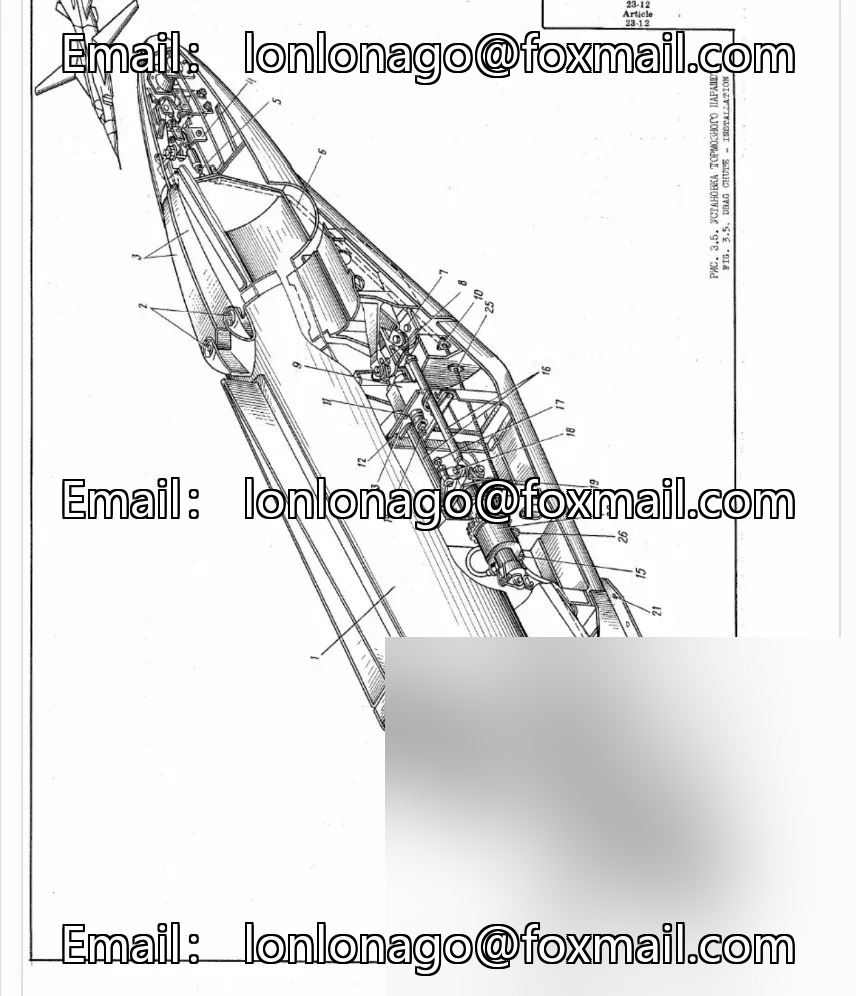
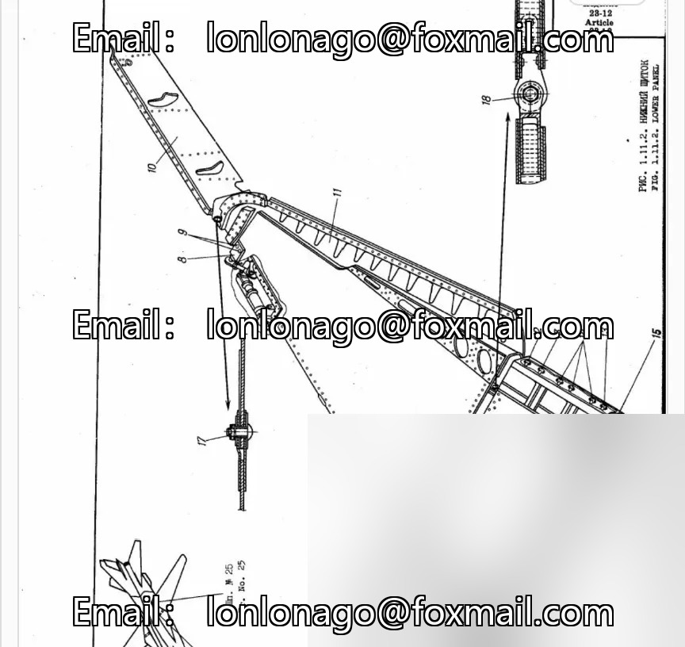

# Mig 23 airframe structure diagram and maintenance materials

## Body

MIG 23 body structure diagram and maintenance materials (MIG 23-MF body structure diagram (Volume 01, Pages 472); MIG 23-23M comprehensive technical description (Volume 01, Pages 663))
MIG23-2312B-01-Body Structure (369 pages)
Mig-23 (23-12B) maintenance (688 pages)

14109
71667
37996
705204
no return upon sale.

The images include the MiG 23 body structure, maintenance materials, and multiple numbered pages, along with maintenance-related content.

<!-- AI_ENRICHED -->

## Images

## Payment

Here is a pay link on Stripe ( https://buy.stripe.com/3cs8yP7sY87d0vu9AB ). Please contact me lonlonago@foxmail.com after funding $89, and I will send you a complete data files , thank you!

